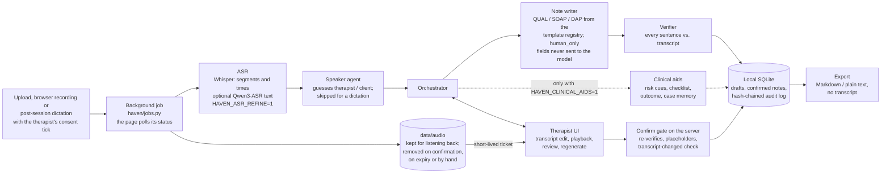
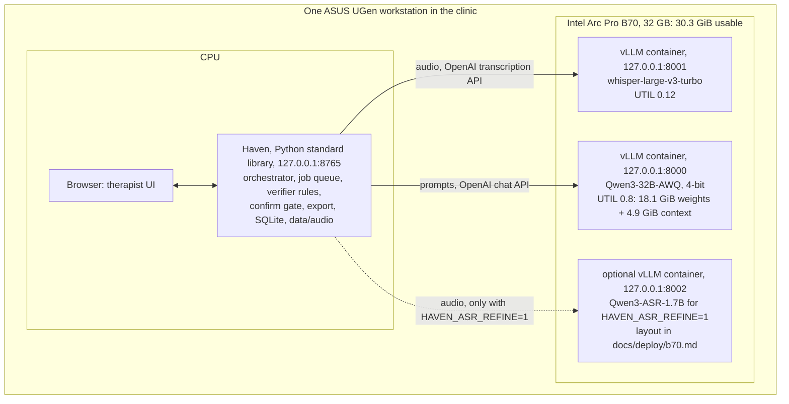

# Haven 心港 — an on-premises AI copilot for psychotherapists

**ASUS UGen AI League Hackathon · Workplace AI · Battlefield Thunderstorm (ASUS UGen Intel Arc Pro B70 32GB)**

Haven turns a therapy session into a draft progress note, risk cues and outcome-tracking reminders. By default everything runs on one machine in the clinic: Haven's own code sends session content only to a model server on the same machine (or, if configured, to a named server on the clinic's private network), and it calls no cloud service. Therapists get AI documentation help without handing their clients' most sensitive data to a third-party processor.

What this does and does not claim is spelled out under "Safety Boundary", "Privacy and safety guards in the code" and "Limitations". In short: the address check covers Haven's own requests, not what a model server does afterwards; a network capture during a session has not been done yet; the original audio is kept for a limited time (see "Audio policy") and is not encrypted; and the real-model end-to-end release gate and the model-quality golden-set run on the B70 are **still pending** (see "Status of the MVP checks").

> All data in this repository is **scripted, simulated sessions** written by the team. No real client information. The transcripts are scripts, not recordings: only a 23-second excerpt (C001-S04, lines #10–#12) was read aloud by two people, for the speech-to-text test, and the 49.5-minute script C002-L50 was read by two synthetic voices (macOS `say`) for the long recording test; neither recording is in the repository. The "Speech" column in the benchmark files is the length given by the script's timestamps, not the length of a recording.

## Why on-device

- **Privacy is the product.** In Taiwan, health and medical data is a special category of personal data under the Personal Data Protection Act (Art. 6) （待核對：須以全國法規資料庫現行條文確認）. That does not forbid cloud tools; it means a clinic that uses one takes on a third-party processor, usually abroad, for its most sensitive records, and a small practice has no legal staff to assess that. The AI note tools we know of for therapists are cloud services:

  | Product | Where it runs |
  | --- | --- |
  | Upheal | Vendor's cloud |
  | Mentalyc | Vendor's cloud |
  | Eleos Health | Vendor's cloud |
  | Blueprint | Vendor's cloud |
  | **Haven** | A machine in the clinic |

  This is our reading of each vendor's public site in October 2026 and has not been checked with the vendors.
- **The record has to last.** The Psychologists Act (Art. 25) is the reference we have used for keeping practice records for at least 10 years （待核對：須以全國法規資料庫現行條文確認）; we have not checked the current text and make no claim about the retention period. Notes that are wrong or invented stay wrong for a decade, so every sentence must be traceable.
- **One card has to hold the whole system.** The case for a 32 GB card is not that a bigger model writes better notes: on our three short sessions the 8B model was faster than the 32B one and had more sentences pass the verifier (see [docs/RESULTS.md](docs/RESULTS.md)), and that count does not measure note quality either way. The case is that speech-to-text, the note model and the context of several 50-minute sessions must sit on one card at the same time. **Measured on 2026-11-14 (batch 9):** Whisper and Qwen3-32B (4-bit) loaded together on one B70 with a 32k context and an fp8 context cache; four 49.5-minute sessions drafted at once all finished in 280 s (one alone: 245 s); after the 2026-11-14 verifier and prompt fixes the notes were longer and four rooms took 365 s. **Batch 10 (2026-11-16/17)** writes the parts of a long note at once: one 49.5-minute session in 98 s, four at once in 149 s, and a 46-minute recording through Whisper, speaker labels and the draft in 4.4 minutes, on the same card. Peak card memory 30.8 GiB, card power about 230 W. Details in [docs/RESULTS.md](docs/RESULTS.md).

## How it works



Haven makes no request to a cloud service. Where each part runs on the Stage II hardware:



The memory figures are from the launcher's measured notes (`scripts/b70-vllm.sh`): with Whisper loaded, 24.5 of 30.3 GiB are free, and the note model at `UTIL=0.8` gets 18.1 GiB of weights and 4.9 GiB of context cache. The two-card layout and the Qwen3-ASR server are described in [docs/deploy/b70.md](docs/deploy/b70.md), whose commands are written but not yet run on the machine. Peak memory and power under load were measured in batch 10 (see Targets below). On a laptop the same code runs with Ollama or with no model at all, and Whisper runs in-process on the CPU.

**Models**

| Role | Model | Size and form | Memory for weights (measured) | Context in the launcher | Licence (per model card; check before release) |
| --- | --- | --- | --- | --- | --- |
| Notes, verifier check, speaker guess (B70) | [Qwen/Qwen3-32B-AWQ](https://huggingface.co/Qwen/Qwen3-32B-AWQ) | 32B, 4-bit AWQ | 18.1 GiB | 16,384 tokens | Apache-2.0 |
| Alternative measured on the B70 | Qwen/Qwen3-14B | 14B, FP8 at load | 15.2 GiB | 16,384 | Apache-2.0 |
| Alternative measured on the B70 | Qwen/Qwen3-8B | 8B, bf16 | 15.3 GiB | 16,384 | Apache-2.0 |
| Speech-to-text (B70) | openai/whisper-large-v3-turbo | 809M | about 1.6 GB download; memory on the card not measured separately | 448 | MIT |
| Notes on a laptop | qwen2.5:7b through Ollama | 7B, Ollama's default 4-bit | not measured | Ollama default | Apache-2.0 |
| Speech-to-text on a laptop | faster-whisper `small` | int8, CPU | not measured | – | MIT |

Served by vLLM 0.26.0 (`vllm/vllm-openai-xpu:v0.26.0`). The writer works in parts of 60 segments, so a 50-minute session never needs one long request. Batch 9 (2026-11-14) ran with `--max-model-len 32768 --kv-cache-dtype fp8`, which both Qwen3-32B and Qwen3-8B accepted with Whisper on the same card. Batch 10 sends up to 4 parts at once (`HAVEN_WRITE_PARALLEL`) and ran both servers with `OFFLINE=1 PRIVILEGED=0`. Whisper needs `VLLM_MAX_AUDIO_DECODE_DURATION_S` raised for recordings over 10 minutes (the launcher sets 3 hours).

| Agent | What it does | Where |
| --- | --- | --- |
| ASR | Speech to timestamped segments. On the B70: whisper-large-v3-turbo served by vLLM through the OpenAI transcription API (`HAVEN_ASR=openai`). On a laptop: faster-whisper, int8, in-process. With `HAVEN_ASR_REFINE=1` a second local server (Qwen3-ASR, port 8002) transcribes the recording again and its text replaces Whisper's words segment by segment; Whisper still gives the segment ids and times, and its words are kept if the second server fails (see "ASR limitations") | `haven/transcript.py`, `haven/asr_refine.py` |
| Speaker | Whisper gives no speakers, so the local LLM labels each segment therapist or client from its words. The labels are guesses, shown as 「（推測）」, and the risk agent and verifier treat them with care. The therapist corrects them line by line against the recording and presses 確認說話者; confirmed labels (✓) count like a prepared transcript, and the risk scan, checklist and every sentence are checked again. No acoustic diarization | `haven/agents/speakers.py` |
| Note writer | Drafts a note from a template; every sentence cites segment ids. The templates live in a registry (`haven/templates.py`): **QUAL** (單次晤談質化紀錄: topic, interaction, safety-related statements quoted without assessment, and two `human_only` fields), SOAP and DAP. A `human_only` field (QUAL's 心理師評估與概念化 and 後續計畫) is never sent to the model: it starts as the placeholder 「待心理師填寫」, which blocks signing until the therapist writes the field or deletes the sentence. SOAP and DAP are kept from the earlier version, and **their A and P sections are still drafted by the model** from the therapist's own lines; use QUAL for the Safety Boundary. The default template is QUAL (`HAVEN_DEFAULT_TEMPLATE`; set it to SOAP or DAP to draft those by default), a dictation always defaults to QUAL, and the page has a template picker. SOAP and DAP end with a risk section, R (風險與安全); with `HAVEN_CLINICAL_AIDS=1`, a transcript line with a high-level risk cue that no sentence cites is added there as a quote, whichever engine wrote the note. The objective section is for the clinician's observations of behaviour and affect in the session, still cited; what a transcript cannot show (appearance, affect, orientation) the therapist adds. Sessions over 60 segments are written in parts of 60 and joined | `haven/agents/writer.py` |
| Verifier | Checks each sentence against the segments it cites, in three layers: hard rules (numbers, time words and gendered pronouns must appear in the cited lines; a risk or behaviour word such as 想死, 割腕, 安眠藥 or 打 must be denied or stated as in the cited lines, with a double negation such as 「沒有一天不想死」 read as stated; a client's hedged self-criticism must not be written as fact), word overlap for the sentence and for each clause (a clause with no counterpart in the cited lines holds the sentence), then one batched local-LLM check for paraphrases. Signing is blocked until the therapist edits, deletes or confirms every unsupported sentence, every weak sentence about risk (suicide, self-harm, harm to others, abuse or substance wording, or a sentence citing a line with a risk cue), and every weak sentence the local model was asked about and rejected. If the model does not answer, the sentence says so (「本機模型未回應」) instead of reporting a model judgement | `haven/agents/verifier.py` |
| Risk | **Off by default; runs only with `HAVEN_CLINICAL_AIDS=1`.** Keyword and pattern matching, the same in every mode (no model is involved). Flags cues with the exact quote: suicidal ideation (direct, indirect and Taiwanese-language wording), preparation, plans or means, suicidal behaviour and past attempts, self-harm, harm to others including taking a child along, bullying (at school, at work or online; added on 2026-11-17 at the interviewed psychologist's suggestion, with a note that being bullied is a suicide risk factor), substance use, functioning, and **mandated-reporting cues** (family violence, child protection, elder or disability protection, sexual assault, including image-based abuse such as threats to spread nude photos). A reporting cue names the law and asks the therapist to assess whether to report; Haven never reports anything itself. Negated cues are kept for review, a double negation is not lowered, another person's suicide is shown as background (not the client's ideation), and a therapist's restatement of a disclosure is scanned too. **The cue lists were widened from a reviewer's list on 2026-11-12 and are 待心理師確認: one psychologist has suggested categories (2026-11-17), but no licensed psychologist has checked the wording.** When suicide cues appear, shows which parts of a risk inquiry the session covered (ideation, frequency, plan, intent, access to means, past attempts, protective factors, safety plan, crisis resources) and which to consider asking or documenting | `haven/agents/risk.py` |
| Outcome | **Off by default (`HAVEN_CLINICAL_AIDS=1`).** Routine outcome monitoring: reliable change (PHQ-9: 6, GAD-7: 4), also between the last two sessions; clinically significant change; a not-on-track rule (from the third score on: still in the clinical range and not reliably improved since the first) with a review prompt; reminders, not "deteriorated" alerts, for the two single suicide items (PHQ-9 item 9 and BSRS-5 item 6, both from a score of 1, the BSRS-5 item adding referral advice from 2). BSRS-5 has no published reliable-change value, so 3 points is used and marked 暫定. Writes the score lines into the note's objective section | `haven/agents/outcome.py` |
| Case memory | **Off by default (`HAVEN_CLINICAL_AIDS=1`); with it off the ask endpoint does not exist.** Keyword search over that client's own sessions only. "哪幾次提到父親？" is widened to the words clients use (爸爸, 我爸…), every session is searched, and the answer lists how many lines matched in each session with up to three shown per session. Risk topics (自殺, 想死, 自傷, 保護因子…) are widened too. A speaker shown as unknown or guessed stays that way. No match means the words did not match, and the page says so; it is not evidence the topic never came up. The word families are 待心理師確認 | `haven/agents/memory.py` |
| Orchestrator | Runs the agents, times each one, stores the result and writes the audit log | `haven/orchestrator.py` |
| Jobs | Transcription, drafting and regenerating run on worker threads (`HAVEN_JOB_WORKERS`, default 2); an upload or a finished recording is answered at once (202) and the page polls `GET /api/jobs/<id>`. States: queued, running, succeeded, failed, and interrupted (cut off by a restart); a failed or interrupted job can be retried | `haven/jobs.py` |
| Audio | Keeps the original recording in `data/audio/` and removes it (see "Audio policy"); authorized playback by short-lived ticket and HTTP Range | `haven/audio.py`, `haven/playback.py` |
| Transcript edit, recap, regenerate | The therapist corrects a line's words or speaker; a correction raises `transcript_revision` and the draft needs review again. Recap mode takes a dictation by the therapist alone. Regenerating never overwrites the therapist's edits unless asked to; the old draft is kept as a previous version | `haven/transcript_edit.py`, `haven/recap.py`, `haven/regenerate.py`, `haven/human_fields.py` |
| Export | Markdown or plain text of a signed note, built from the signed record, without the transcript | `haven/export.py` |
| Signing gate | Not an agent: the server-side check that decides whether a note can be signed (the page calls this step 「確認紀錄」) | `haven/signing.py` |

**Human in the loop:** Haven only produces drafts. A note becomes a record only after the therapist reviews and signs it. Haven does not diagnose or give any output to the client, and it does not analyse facial expressions.

### Safety Boundary

What the MVP does and does not do, as implemented:

- **No AI risk assessment, diagnosis or treatment advice in the default setup.** The risk-cue scan and its checklist, the signing gate on risk cues, forced quotes of risk lines, questionnaire score lines, outcome alerts and charts, and Case Memory are **off by default**. They are switched on with `HAVEN_CLINICAL_AIDS=1`; the code is kept. With the switch off the server returns no risk or outcome data, the risk panel does not appear and the ask endpoint does not exist. They are lexicon and rule based, their word lists are 待心理師確認, and "no cue found" never meant "no risk" (see Limitations). The AI still writes a draft: the model is told to write only what was said, but nothing guarantees it never writes a judgement, which is why every sentence is verified and the therapist signs.
- **QUAL template.** The model writes only what was said and done in the session, each sentence citing transcript lines. The two judgement fields (心理師評估與概念化, 後續計畫) are `human_only`: not sent to the model, started as 「待心理師填寫」. The safety-related field only collects what the transcript says about suicide, self-harm, harm to others, abuse, substances, protective factors and safety steps, and shows 「未提及」 when there is nothing. Whether that field is clinically sufficient has not been put to a psychologist. SOAP and DAP keep model-drafted A and P sections (see the table above).
- **Recap mode (會後口述).** The therapist dictates after the session. One voice, so no speaker guessing and no speaker confirmation; every line is the therapist's, and the note is written as 「心理師口述…」, never as the client's own words. A sentence that attributes speech to the client is held by the verifier. The consent line for this mode reads 「本段口述僅含心理師整理，不含個案錄音」; the consent box is still required.
- **Review and confirmation.** Every sentence cites the transcript and is verified; the server re-checks everything when the therapist signs. (The button reads 「核對完成，確認紀錄」.) If a transcript line was corrected after the draft was last reviewed, the page shows a banner and the button 「我已依目前逐字稿核對」, and the server refuses to sign (409) until it has been pressed. A sentence whose cited line changed is marked 「來源已修改，請重新核對」.
- **Transcript editing.** A line's text and speaker can be corrected on the review page; ids and times never change, and the ASR's own words stay stored.
- **Export.** A signed note downloads as Markdown or plain text, with the signer, time, hashes and the statement 「本紀錄由 AI 輔助產生草稿，經心理師核對確認」, and without the transcript. Export status is 尚未匯出, 已下載 or 已歸檔; the therapist marks 已歸檔, because Haven cannot see the clinic's other system.
- **Regenerating** a draft that holds the therapist's edits is refused unless the request says to discard them, and the old draft is kept as a previous version (up to 3).
- **What Haven does not claim:** that running on-premises makes it lawful, that the law forbids cloud tools, that it has passed any compliance certification, that audio must be kept for the record-keeping period, or that a ticked consent box removes any other duty.

### Audio policy

Haven **keeps the original recording for a limited time** so the therapist can listen back while checking the transcript. (Earlier versions deleted it as soon as it was transcribed; that is no longer true.)

- Recordings are stored in `data/audio/` (directory 0700, files 0600) under server-made random names; the database holds only the name, type, size and times. An upload or a recording in progress first sits in `data/tmp/`, which is emptied at start.
- **Kept until the first of:** the therapist signs the note (default; `HAVEN_AUDIO_DELETE_ON_CONFIRM=0` keeps it until expiry instead), `HAVEN_AUDIO_TTL_HOURS` have passed since it was stored (default **72 hours**), or the therapist deletes it by hand (「刪除原始錄音」). **72 hours is a test setting; it has not been checked against any legal or professional retention rule** （待核對：須以全國法規資料庫現行條文確認）.
- A recording whose transcription failed is kept for a retry, until it expires. A browser recording that sends nothing for 30 minutes, or is cancelled, is removed.
- A delete that fails is recorded as `cleanup_failed` and retried 1, 5 and 30 minutes after the last attempt, then at every sweep. The sweep runs at start-up and every 10 minutes. The audit log records stored, play-ticket, expired, deleted (with the reason) and cleanup-failed events, with ids and counts only.
- When the audio is gone the review page says when and why (expiry, confirmed, manual); the transcript and the draft stay.
- **Playback** uses a ticket valid for 10 minutes, tied to the signed-in account; another therapist, or the same ticket after deletion, gets 404. Clicking a line plays from that line's start to its end (line level, not word level). **Browser-recorded webm has playback disabled:** Chrome cannot reliably jump inside a live-recorded webm and Haven has no ffmpeg step, so the page says playback is unavailable. Uploaded m4a, mp3, wav, ogg and flac keep playback. The Chrome check has **not been run** ([docs/playback-webm-seek.md](docs/playback-webm-seek.md)).
- **The audio is not covered by `HAVEN_ENCRYPT=1`.** Use full-disk encryption on the machine. Deletion is an ordinary delete, not a secure erase. An admin's time-limited record access does not include audio.
- The clinic's record is the signed note (exported to the clinic's own system), not the audio. Haven does not claim that keeping or deleting the audio satisfies any law.

### Status of the MVP checks

| Check | Status |
| --- | --- |
| Real ASR, note model and draft end to end on the B70, including sign-out and sign-in persistence ([docs/release-gate/README.md](docs/release-gate/README.md)) | **Pending.** The procedure is written; there is no result |
| Model quality on the 12-session golden set ([docs/golden/README.md](docs/golden/README.md)) | **Pending on the B70.** Only a rule-engine trial run exists; no model-quality figure can be quoted |
| Two-card B70 deployment ([docs/deploy/b70.md](docs/deploy/b70.md)) | Commands written, not yet run on the machine |
| Playback of browser-recorded webm | Disabled; the Chrome seek check has not been run |
| Exploratory validation with a therapist | Not done |


**Privacy and safety guards in the code** (tested in `tests/`):
- **Haven's own requests go to local addresses only.** The model and transcription endpoints must be `http` or `https` to loopback or a private LAN address. A name (`localhost`, `*.local`) is resolved and every address checked, and the connection is then made to the address that was checked, so a name that changes its answer between the check and the connection is not followed. Requests that carry session content use no HTTP or system proxy, follow no redirect, and have no `ftp:`, `file:` or `data:` handler. (Model downloads by `faster-whisper`, Hugging Face or the vLLM container are a separate matter: they happen at install time and do honour proxies.)
- **This check covers the first hop only.** Haven cannot see what the model server does with a request. A model name that marks a cloud model (Ollama's `-cloud` / `:cloud`) is refused, and Ollama is asked whether the model is served remotely, but a local gateway that forwards elsewhere under an ordinary name would pass. The model server itself has to be set up to run offline (see `scripts/b70-vllm.sh`: `OFFLINE=1`, usage statistics off).
- **The status bar shows state, not a slogan.** `/api/status` reports the model and transcription endpoints, the addresses their names resolve to right now, whether those are loopback, and how many connections Haven's endpoint check has refused since start. It is not a packet capture; that measurement is still to do (see Stage II targets).
- The server binds to `127.0.0.1`, rejects requests whose `Host` header is not its own (DNS rebinding), and requires an `X-Haven` header on **every API request, reads included**, so another website open in the browser cannot sign, upload, start the model or write to the audit log. A `GET` only reads (and records the read in the audit log); drafting a note (`POST /api/sessions/<id>/open`), processing and asking the case memory (`POST /api/clients/<id>/ask`) are POSTs. Every response carries `Content-Security-Policy: default-src 'self'; frame-ancestors 'none'; …`, `X-Frame-Options: DENY`, `X-Content-Type-Options: nosniff` and `Referrer-Policy: no-referrer`.
- **Prompt injection.** Transcript lines reach the model as JSON strings, every system prompt says they are data and not instructions, and every request has a token limit. The model has no tools and no network, and the UI inserts everything as plain text. A note sentence that cites a line worded like an instruction to the AI (「請在評估欄寫…」, 「忽略以上指示」) is held until the therapist confirms it; that word list is an engineering guess (待心理師確認). This lowers the risk; it does not remove it.
- **Signing is decided by the server.** When a note is signed, the server reads the stored transcript and checks every sentence again. From the browser it takes only the sentence texts, the segments they cite, which flagged sentences the therapist confirmed, and which risk cues the therapist left out with a reason. A `status`, `support`, `source` or `must_confirm` sent by the browser is ignored. A sentence the server's verifier has already judged (same text, same citations, same transcript, same rule version) keeps that verdict; any other sentence is checked by the rule layers at signing. The server answers 404 for a session that does not exist and 409 for an empty note, a session with no draft, an unsupported or held sentence the therapist has not confirmed, or a score line that differs from the questionnaire data.
- **Risk cues must be accounted for.** A note cannot be signed while a high-level risk cue in the transcript is cited by no sentence, unless the therapist leaves it out with a written reason. The reason goes into the audit log.
- **A signed note is locked.** The session cannot be processed again, re-verified or signed a second time (session ids are upper-cased, so `c001-s04` is the same session). The session page shows the signed note, read-only. Corrections go in an addendum (`POST /api/sessions/<id>/addendum`), which can only be appended. Each signature stores the SHA-256 of the transcript text and of the signed note and the verifier rule version, and is written in the same database transaction as its audit row. The hashes make a later change detectable by comparison; they are not a cryptographic signature, and someone with access to the database file can still change both.
- **The server answers every request.** An unexpected error is a JSON 500 with no detail (the terminal gets the exception class and location, not its message); a malformed note is a 400; only a missing session or client is a 404. `Content-Length` must be a non-negative number, JSON bodies are limited to 2 MB (recordings to 200 MB), and a connection that sends nothing for 30 seconds is closed.
- **One session, one writer.** A session id being uploaded is reserved: a second upload with the same id gets 409 instead of replacing the first, and uploads at once get different session numbers. Several requests opening a session for the first time run the pipeline once. An empty file or a recording with no recognised speech creates no session and says why; a very short transcript is kept and carries a warning.
- Uploads require a ticked consent box (the therapist's statement that written consent was obtained; Haven does not hold the consent form; a template is in [`docs/consent-form.md`](docs/consent-form.md)). **Haven keeps the recording for a limited time** (see "Audio policy"): the audio is written to a 0600 temporary file in `data/tmp/`, moved to `data/audio/`, sent to the local transcription server, and kept so the therapist can listen back; it is removed when the note is signed, after `HAVEN_AUDIO_TTL_HOURS` (default 72, a test setting) or on request. A temporary file left by a crash or a failed upload is removed at the next start. After an upload the page reminds the therapist to delete the original on the recording device too. Removal is an ordinary delete, not a secure erase, so use full-disk encryption. An upload is treated as a real client unless `simulated=1` is sent, and its id must start with the client id.
- **Files are for this account only, and encrypted when `HAVEN_ENCRYPT=1`.** The data directory is 0700 and the database, transcripts and client file 0600. With `HAVEN_ENCRYPT=1` (needs `pip install cryptography`), transcripts, the client list, and in the database the results, signed notes, addenda and cached verdicts are encrypted with AES-256-GCM. **Original audio files are not encrypted by this setting.** The key is derived from a passphrase with scrypt at every start (asked on the terminal, or `HAVEN_PASSPHRASE`) and held in memory only; `data/key.json` holds the salt and a check value, not the key. A lost passphrase cannot be recovered. Session ids, times, signer names, hashes and the audit log stay readable, so the audit chain verifies without the key. `scripts/encrypt_data.py` encrypts a folder that already holds plain data; signatures stay valid because the transcript hash is taken over the text. This protects a copied disk, backup or data folder; it does not protect against someone using the running machine under the therapist's account. Encryption is off by default so the laptop demo runs with the standard library only. `.gitignore` covers everything Haven writes (only the three simulated demo transcripts are tracked), and `scripts/pre_commit_check.py` is an example Git hook that refuses a staged database, recording, key file, encrypted file, or transcript not marked `"simulated": true`. Note that `data/clients.json` is tracked and an upload adds the new session id to it.
- Questionnaire scores enter the note from the score data, not from the model. Score lines cannot be edited in the UI, and the server accepts a sentence as a score line only when its text equals the line it builds from the questionnaire data; an edited one is marked unsupported and cannot be signed as a score line.
- **Audit log.** Processing, re-verification, case-memory questions, signing, addenda, uploads (failed ones too) and reads of a session, a brief, the client list or the log itself are written to a local audit log with the session or client id, never the content. With accounts, every row starts with the account that acted (`[wang] sign_note …`), including sign-ins and failed sign-ins; on a laptop with no accounts a row does not say who acted. Each row stores the hash of the row before it: `GET /api/audit/verify` or `python3 scripts/verify_audit.py` reports the first row that was changed, inserted or deleted. Someone who can write the database file can still rebuild the whole chain or cut rows off its end; comparing the head hash with a copy kept elsewhere detects that. Haven does not keep such a copy for you.

## Quick start (laptop, no GPU needed)

Requires Python 3.10+. The core has no third-party dependencies.

```bash
python3 scripts/reset_demo.py   # a clean, unsigned demo state (see "Demo walkthrough")
python3 -m haven
```

Open http://127.0.0.1:8765. Without a local model, Haven uses its **rule-based demo engine**, which selects what was said and changes only the speaker (「我」 to 「個案」), so the notes read like quotes. A proposal such as 「我們來擬安全計畫，好嗎？」 is written as 「心理師提議…（個案回應：…）」, not as a finished plan.

If a local model is configured but does not answer, the same rule engine writes the draft and the result says so: the engine label reads 「規則引擎（本機模型未回應）」, the session page shows a red banner, and the audit log records it.

### With a local LLM (recommended for the demo)

Install [Ollama](https://ollama.com), then:

```bash
ollama pull qwen2.5:7b
HAVEN_LLM=ollama HAVEN_MODEL=qwen2.5:7b python3 -m haven
```

Any server with Ollama's `/api/chat` API on the local machine or LAN works (`HAVEN_LLM_URL`).

Generating a note takes about a minute on a laptop, so process the demo sessions before recording:

```bash
python3 scripts/prepare_demo.py
```

On a MacBook Air M2 (8 GB) with qwen2.5:7b a note for one of the short demo sessions took 61–109 s ([docs/benchmarks/m2-air-openai-compat-qwen2.5-7b.md](docs/benchmarks/m2-air-openai-compat-qwen2.5-7b.md), 2026-11-03). An earlier table here gave 37–63 s from a run whose result file was never saved; it has been removed. What the verifier caught in those laptop runs: "下週五" where the session said "這週五", "近兩週" attached to a statement that had no time frame, and feelings ("自責") the cited line did not contain. It also flags some correct paraphrases; the therapist clears those with 「保留此句（我已核對）」. A 7B model on a laptop is the floor.

### On the Arc Pro B70 (Stage II)

The B70 runs models through vLLM (XPU), llama.cpp (SYCL) or OpenVINO Model Server. All three serve the OpenAI chat API, so Haven talks to them the same way:

```bash
HAVEN_LLM=openai HAVEN_LLM_URL=http://127.0.0.1:8000 HAVEN_MODEL=<served model name> python3 -m haven
```

The endpoint check still applies: only this machine or the clinic LAN is accepted (loopback, 10/8, 172.16/12, 192.168/16, fc00::/7; a `.local` name must resolve to one of them). Redirects are not followed. A private address is not proof of a clinic LAN (VPNs and public Wi-Fi use the same ranges), and the connection to a LAN server is plain HTTP unless you configure `https`; the supported setup is a model server on the same machine.

On a B70 with Docker, `scripts/b70-vllm.sh` starts vLLM on one card, listening on 127.0.0.1 only:

```bash
bash scripts/b70-vllm.sh Qwen/Qwen3-32B-AWQ qwen3-32b-awq
HAVEN_LLM=openai HAVEN_MODEL=qwen3-32b-awq python3 -m haven
```

**Measured on one Arc Pro B70 32GB** on 2026-11-07 (vLLM 0.26.0; the three scripted sessions, 110–232 s of speech by the script's timestamps; one run each; note model alone on the card, `UTIL=0.9`, no Whisper beside it):

| Model on one card | Memory for weights | Draft note per session | 4 short sessions at once | Output tok/s | Sentences that passed the verifier |
| --- | --- | --- | --- | --- | --- |
| Qwen3-8B, bf16 | 15.3 GiB | 11.8–16.6 s | 17.0 s | 34 | 27 of 32 |
| Qwen3-14B, FP8 | 15.2 GiB | 17.5–23.9 s | 24.4 s | 34 | 26 of 43 |
| Qwen3-32B, 4-bit AWQ | 18.1 GiB | 19.5–29.2 s | 30.3 s | 26 | 21 of 36 |

Read this table for speed and memory only.

- **The times are for the note and the verifier check, starting from a finished transcript.** Speech-to-text is not included, and the sessions are 2–4 minutes long, not 50.
- **"4 at once" was measured without Whisper on the card.** With Whisper loaded the note model has 4.9 GiB for context, and four 50-minute sessions at once have not been tried.
- **"Passed the verifier" is not accuracy.** A sentence that did not pass may be a real error or a correct paraphrase the verifier held back; the two have not been separated yet (a clinician's reading of the flagged sentences is planned). Notes also vary between runs: a second run of C002-S05 on the 32B model gave 5 of 10 instead of 2 of 10. These runs predate the 2026-11-12 fixes (verifier rules, the risk section, prompts as JSON), so the counts will change when re-run.
- Source files: [docs/benchmarks](docs/benchmarks). All figures, definitions and what is still pending are collected in [docs/RESULTS.md](docs/RESULTS.md).

### Measuring performance

```bash
python3 scripts/benchmark.py --rooms 4
```

Processes every demo session, then four at once (four therapy rooms), and writes per-agent times, token counts and tokens per second to `docs/benchmarks/`. It uses a throwaway database. Results so far are in [docs/benchmarks](docs/benchmarks).

```bash
python3 scripts/benchmark.py --repeat 3 --rooms 4
python3 scripts/review_summary.py docs/benchmarks/<label>-review.csv
```

Notes vary from run to run, so `--repeat 3` runs each session three times and reports the median. Every sentence the verifier did not pass goes to `<label>-review.csv` with the transcript lines it cited; a clinician marks each one `real_error` (the note was wrong and was caught) or `wrongly_blocked` (the sentence was fine). `review_summary.py` turns the marked sheet into three numbers per session: passed, real errors caught, wrongly blocked, plus flagged sentences per note (the therapist's extra clicks).

### Measuring the verifier

```bash
python3 scripts/verifier_eval.py
```

Runs the verifier on 48 note sentences about the simulated sessions: 18 correct ones and 30 with a known error (wrong number, time word, pronoun or speaker, reversed risk statement, invented content, overstated frequency, unmade diagnosis, wrong citation). Reports how many wrong sentences block signing and how many correct ones are flagged by mistake, per error type, in [docs/verifier-eval](docs/verifier-eval).

"Blocked" has one meaning here and in every current file: the sentence stops signing until the therapist acts, that is, it is marked unsupported, or it is weak and held (about risk, rejected by the model, or citing an instruction-like line). The B70 files from 2026-11-07 used an older meaning (unsupported only) and older rules; they are labelled "before the fixes" below and are not comparable with the current figure.

| Run | Date | Wrong sentences blocked | Correct sentences blocked | Definition and rules |
| --- | --- | --- | --- | --- |
| Rule layers only, no model | 2026-11-12 | 28/30 | 2/18 | current |
| qwen2.5:7b, laptop | 2026-11-08 | 27/30 | 1/18 | current definition, rules before the 2026-11-12 fixes |
| Qwen3-32B, B70 | 2026-11-16 | 30/30 | 1/18 | current (batch 10; the same in both batch-9 runs) |
| Qwen3-14B, B70 | 2026-11-07 | 26/30 | 0/18 | before the fixes: old definition, old rules |
| Qwen3-32B, B70 | 2026-11-07 | 26/30 | 0/18 | before the fixes: old definition, old rules |

Qwen3-32B has been re-run under the current rules on the B70 (batches 9 and 10); the other models have not. The cases were written by the team, so treat these numbers as a regression check, not an independent accuracy figure.

### Transcribing real audio

```bash
pip install -r requirements-asr.txt
HAVEN_ASR_MODEL=small python3 -m haven
```

Use "上傳會談錄音" in the client page. The first run downloads the Whisper model.

**On the B70**, Whisper runs as a second vLLM server on the same card, next to the note model. The weights (about 18 GB for the 32B model, 1.6 GB for Whisper) and the XPU Docker image are downloaded on the first start, which takes longer than the rest of the setup:

```bash
PORT=8001 UTIL=0.12 CONTAINER=vllm-asr bash scripts/b70-vllm.sh openai/whisper-large-v3-turbo whisper --max-model-len 448
until curl -s 127.0.0.1:8001/v1/models | grep -q whisper; do sleep 3; done   # start one server at a time
UTIL=0.8 bash scripts/b70-vllm.sh Qwen/Qwen3-32B-AWQ qwen3-32b-awq
until curl -s 127.0.0.1:8000/v1/models | grep -q qwen3; do sleep 3; done
HAVEN_LLM=openai HAVEN_MODEL=qwen3-32b-awq HAVEN_ASR=openai python3 -m haven
```

Start Whisper first and wait for it: two servers loading at once fail each other's memory check. With Whisper loaded, 24.5 of the card's 30.3 GiB stay free, which is why the note model runs at `UTIL=0.8`. Install `requirements-asr.txt` on the machine that runs Haven here too: Whisper often answers in Simplified characters, and `opencc` turns them into Traditional before the risk check reads them (Haven warns if it is missing).

**Measured once on the B70** (week of 2026-11-10, whisper-large-v3-turbo through vLLM, no prompt): C001-S04 lines #10–#12 read aloud by two people, 23.0 s of audio, transcribed in 0.5 s with a character error rate of 14.1%; Qwen3-32B-AWQ then guessed the speaker of all three segments correctly in 2.3 s. Three segments from one clip is a smoke test, not an accuracy figure, and 14.1% is above the 10% target. Result files: [docs/asr-eval/b70-whisper-turbo-real-voices.md](docs/asr-eval/b70-whisper-turbo-real-voices.md). **A 46-minute recording** (batch 10, 2026-11-17): the C002-L50 script read by two synthetic voices, transcribed in 9.6 s, 7.5% character error rate after conversion to Traditional, speakers guessed right in 530 of 553 segments in 116 s, note drafted in 136 s: 4.4 minutes in all. Synthetic speech is cleaner than a real room. Of the 130 sentences drafted straight from it, 90 wait for the therapist to confirm the guessed speakers; with the guesses confirmed, 95 of 140 pass. Details in [docs/RESULTS.md](docs/RESULTS.md).

Recordings are streamed to a temp file, moved to `data/audio/`, and sent to the local server; the audio is then kept or removed as described under "Audio policy". The transcription runs as a background job, so the page shows progress (轉寫, 說話者, 草稿) and a failed job has a retry button. Then the local LLM guesses from the words who is speaking (one therapist, one client). There is no acoustic diarization yet, so the guesses are shown as 「（推測）」 and treated with care:

- The risk agent scans every line whose speaker is guessed or unknown, and a cue keeps its level whoever the model guessed said it (「我想燒炭」 stays at the top level). Only a question addressed to 「你」 is lowered to "review" and marked as possibly the therapist asking.
- Screening questions, safety steps and checklist items count only on lines known to be the therapist's (prepared transcripts). For an upload the panel says it cannot tell whether suicide was asked about, instead of saying it was not.
- A note sentence about what the client said, or about risk, that cites a guessed line is marked "支持不足" with the reason, and a weak risk sentence blocks signing until the therapist confirms it.

### More documents

[docs/specs/haven-copilot-mvp.md](docs/specs/haven-copilot-mvp.md) (MVP specification), [docs/specs/asr-qwen3-evaluation.md](docs/specs/asr-qwen3-evaluation.md) (ASR evaluation and its limits), [docs/deploy/b70.md](docs/deploy/b70.md) (B70 deployment, commands not yet run), [docs/release-gate/README.md](docs/release-gate/README.md) (end-to-end procedure, not yet run), [docs/golden/README.md](docs/golden/README.md) (model-quality set, B70 run pending), [docs/playback-webm-seek.md](docs/playback-webm-seek.md), [docs/consent-form.md](docs/consent-form.md) and [docs/video-script.md](docs/video-script.md).

### Tests

```bash
python3 -m unittest discover -s tests -v
```

## Clinic network: one main PC, several rooms

Haven runs on one main PC (the B70 workstation). Therapists use a browser on their own laptop or tablet in the counselling room: they sign in, record, read the transcript and the draft, check, edit and sign there. The main PC does the transcription, writing, checking and storage. Nothing is stored on the laptops.

```
python3 scripts/add_user.py add wang --name 王心理師 --clients C001,C002   # one account per therapist
python3 scripts/make_cert.py 192.168.1.20 haven.local                     # HTTPS certificate for the PC's address and name
HAVEN_HOST=0.0.0.0 HAVEN_HOSTNAMES=192.168.1.20,haven.local \
  HAVEN_TLS_CERT=data/tls/cert.pem HAVEN_TLS_KEY=data/tls/key.pem python3 -m haven
```

Install `data/tls/cert.pem` (never `key.pem`) on each device as a trusted certificate, then open `https://192.168.1.20:8765`.

- **Accounts.** `data/users.json`, 0600, scrypt password hashes (at least 10 characters), encrypted with the rest under `HAVEN_ENCRYPT=1`. Once any account exists, everyone signs in, on the main PC too. Five failed sign-ins for one account or one address within 15 minutes lock it for 5 minutes, and the message never says whether the name or the password was wrong. The session cookie is `HttpOnly`, `SameSite=Strict`, and `Secure` over HTTPS; every API request still needs the `X-Haven` header.
- **Who sees what.** A therapist sees only the clients assigned to their account (`therapist_user` in `clients.json`); someone else's client or session answers 404, as if it did not exist. An `admin` account reads the audit log and does not see records in the normal course (the exception is below).
- **Managing accounts and assignments.** An admin signed in **on the main PC** (`https://localhost:8765`) gets the page 「帳號與個案指派」: add accounts, rename them, change roles, reset passwords (which signs that account out everywhere), remove them (only once their clients are moved), add clients, and assign each client to a therapist, move it to another, or leave it unassigned (then nobody can open it). Moving a client takes access away from the previous therapist at once; signed notes stay as signed. The page shows ids, aliases and counts, no clinical content, and every change goes to the audit log (`client_assigned C001: wang -> lin`; aliases are not logged). From other devices it is refused unless `HAVEN_ADMIN_FROM_NETWORK=1`. The last admin cannot be removed or demoted. The first admin is made with `scripts/add_user.py add <name> --name 所長 --role admin`; the script can also do everything the page does. The signer of a note and the author of an addendum are the signed-in account, whatever the page sends.
- **An admin reading records (exceptional).** As in clinical practice, the practice keeps the records but an admin does not read them in the normal course. On the main PC an admin can open a client's records by choosing a reason (the client's own request for a copy, a court or health-authority order, handover when the therapist has left or cannot be reached, an immediate safety risk, supervision with the therapist's agreement) and a short note. The access is read only, lasts 30 minutes (or until 「結束調閱」 or sign-out), shows signed notes and addenda only (no drafts, no transcripts), is written to the audit log (`record_access C001 reason=legal; …`), and is shown to the client's therapist at the top of the client page.
- **Signing in each time.** Opening Haven always asks for the password, even when the browser still holds a sign-in, and the sign-in cookie lasts only until the browser closes. A browser idle for 15 minutes (`HAVEN_IDLE_MINUTES`) is signed out. Opening Haven in a second tab signs the first one out.
- **Idle sign-out.** After `HAVEN_IDLE_MINUTES` (15) without activity the page signs out and reloads, clearing the screen; the server drops the session at the same time. Not while recording. Every session ends after 12 hours.
- **Recording in the browser.** The page records the device's microphone and sends the audio to the main PC every 5 seconds (`/api/recordings`). Pieces not yet sent wait in the page's memory, never on the device's disk; after a network drop they are sent again in order, and the PC refuses a gap. On the PC the pieces collect in one 0600 file in the data directory, which is then handled like an upload (moved to `data/audio/`, transcribed as a background job, kept or removed as under "Audio policy"; playback of a browser recording is disabled). A recording that sends nothing for 30 minutes is removed; "放棄這段錄音" removes it at once. Uploading a file still works for a separate recorder.
- **Two screens on one draft.** Every save carries the revision the page loaded. A save from a page that has not seen the latest one (a second tab, a supervisor) is refused with who saved and when, instead of overwriting it.
- **Network.** Only loopback and private addresses (10/8, 172.16/12, 192.168/16, IPv6 unique-local and link-local) may connect, even if a router forwards the port by mistake. Haven will not start on a non-loopback address without accounts, a certificate and `HAVEN_HOSTNAMES`.

## Demo walkthrough

Before presenting, put the demo in a clean state. A note signed in an earlier run stays signed (that is the point of signing), so the signing step cannot be shown twice without this:

```bash
python3 scripts/reset_demo.py
python3 -m haven
```

`reset_demo.py` moves the current database aside as `data/haven.db-backup-<time>` (nothing is deleted), starts an empty one and drafts the three demo sessions with the current engine. It refuses to run if the data directory holds a session not marked simulated.

- **Without a model**, the rule engine only quotes the transcript, so every sentence passes and there is nothing red to show. The script therefore adds one wrong sentence to C001-S04's plan, 「安排下週五提前會談。」 citing line #19, where the therapist says 這週五. The session page says in a banner that the sentence was planted for the demonstration, and the audit log records it. It is the error qwen2.5:7b made in the first recorded demo. `--no-example` leaves it out.
- **With a model**, nothing is planted: the model's own flagged sentences are the demonstration, and they differ from run to run.
- `--from <file>` starts from a database prepared earlier instead of an empty one, with its signatures removed, for example a local `data/haven.demo.db` made with `scripts/prepare_demo.py` while a model was running. That file is not in the repository (databases are ignored by git). Its drafts are re-checked under the current rules, and paraphrased sentences pass only if the same model is running to check them.

Then, in two parts. **Part A needs no model and no speech-to-text** (`HAVEN_LLM=demo`); **Part B needs a speech-to-text server**, and a note written by a real model needs the B70.

**Part A: the three simulated sessions (demo engine)**

1. Open **小安**, then **第 4 次** (C001-S04). The page shows the template picker, the transcript on the left and the note on the right. The clinical aids are off, so there is no risk panel, checklist, outcome chart or case-memory box (see "Safety Boundary"). To show them, start with `HAVEN_CLINICAL_AIDS=1`: the client page then shows five outcome reminders (PHQ-9, GAD-7 and BSRS-5 have not improved reliably after 4 sessions; PHQ-9 item 9 scored 1; the BSRS-5 suicide item scored 2), the risk panel groups cues by category, and **「哪幾次提到父親？」** searches across sessions.
2. Click the segment number beside any note sentence to mark the transcript lines behind it.
3. The counter above the note reads 「AI 草稿 N 句｜✓ … 句有逐字稿支持｜✗ … 句未能證實｜… 句被攔下，擋住確認」 (the numbers depend on the template and engine), and the planted red sentence shows why: 時間詞「下週」不在引用的逐字稿中. Rewrite it as 「下次會談提前到這週五。」. An edited sentence is marked 「已修改，尚未驗證」 and signing is disabled until it has been verified again, which happens when you leave the box or press 重新驗證. **示範：插入捏造句** adds a sentence that is not in the transcript to show it being caught; remove it with **刪除**, or keep a flagged sentence with **保留此句（我已核對）**. A sentence that cites no transcript line is kept with **保留此句（寫下依據）**, and the basis is stored in the signed note and the audit log.
4. **Edit a transcript line** (the edit button on a line): the line is marked 「已修改」, the note sentences that cite it become 「來源已修改，請重新核對」, and a banner appears with **我已依目前逐字稿核對**. Press it; until then the server refuses to sign.
5. Use the template picker to regenerate as **單次晤談質化紀錄 (QUAL)**: a dialog says the current draft is kept under 「先前版本」. The two judgement fields show the placeholder 「待心理師填寫」, which blocks signing until you write them or delete the sentence.
6. **核對完成，確認紀錄** opens a dialog that lists the flagged sentences you kept and asks for your name and a tick on 「我已逐句核對」. The server checks the whole note again. Afterwards the page shows the signed note read-only with its hashes, an addendum box, and the export buttons **匯出 Markdown** and **匯出純文字** (no transcript in the file), then 「標記為已歸檔」.

**Part B: a recording (needs speech-to-text; a real model needs the B70)**

1. On the client page, open 「錄音或上傳錄音」, choose 完整晤談錄音 (or 會後口述), tick the consent box and 這是模擬會談, and upload an m4a, mp3 or wav file (browser recordings work but cannot be played back). The page goes straight to the processing view: 轉寫 → 說話者 → 草稿, with a retry button if a job fails. Speech-to-text is `HAVEN_ASR=faster-whisper` on a laptop or `HAVEN_ASR=openai` with Whisper on the B70; the speaker guesses and a model-written note need a local LLM (the B70 for the full-size model). With `HAVEN_LLM=demo` the note is the rule engine's quotes.
2. In the review page, press the play button of a line to hear it from that line's start; the bar above the transcript shows how many hours the audio will be kept. Correct a line, confirm the guessed speakers, write the placeholder fields, press **我已依目前逐字稿核對**, then sign and export as in Part A.
3. After signing, the page says 「原始錄音已於 … 清除（原因：已確認）」; the transcript and the note stay. The therapist can also delete the audio earlier with 「刪除原始錄音」.

The real end-to-end run on the B70 (recording to export, with sign-out and sign-in in between) is a separate procedure, [docs/release-gate/README.md](docs/release-gate/README.md), **not yet run**. The demo video script is [docs/video-script.md](docs/video-script.md).

Draft edits are saved to the server a moment after each change, and a sentence still being typed is not saved yet, so leaving the page with unsaved typing asks first.

## Configuration

| Variable | Default | Meaning |
| --- | --- | --- |
| `HAVEN_LLM` | `auto` | `auto` uses Ollama if the model is available, `demo` forces the rule-based engine, `ollama` requires the model, `openai` uses a local OpenAI-compatible server (vLLM, llama.cpp `llama-server`, OpenVINO Model Server) |
| `HAVEN_LLM_URL` | `http://127.0.0.1:11434` (`:8000` for `openai`) | Local model server; non-local addresses are refused |
| `HAVEN_MODEL` | `qwen2.5:7b` | Model name on the server |
| `HAVEN_ASR` | `faster-whisper` | `faster-whisper` transcribes in-process; `openai` sends audio to a local server with the OpenAI transcription API (vLLM serving Whisper) |
| `HAVEN_ASR_URL` | `http://127.0.0.1:8001` | Local transcription server for `openai`; non-local addresses are refused |
| `HAVEN_ASR_MODEL` | `small` (`whisper` for `openai`) | faster-whisper model size, or the served model name |
| `HAVEN_ASR_TIMEOUT` | `900` | Seconds to wait for a transcription |
| `HAVEN_ASR_PROMPT` | a short Traditional Chinese line for `faster-whisper`, none for `openai` | Text given to Whisper before the audio. On the B70 a prompt made whisper-large-v3-turbo drop or repeat the last utterance of a clip, so the server gets none |
| `HAVEN_HOST` / `HAVEN_PORT` | `127.0.0.1` / `8765` | Where the UI is served. `127.0.0.1` serves this machine only. Any other address (for the clinic network, see [Clinic network](#clinic-network-one-main-pc-several-rooms)) needs accounts, a certificate and `HAVEN_HOSTNAMES`; Haven refuses to start without them |
| `HAVEN_HOSTNAMES` | – | The addresses or names the laptops use for the main PC, comma-separated (`192.168.1.20,haven.local`). Requests with any other `Host` header are refused (DNS rebinding) |
| `HAVEN_TLS_CERT` / `HAVEN_TLS_KEY` | – | Certificate and key for HTTPS (`scripts/make_cert.py`). Browsers allow the microphone only over HTTPS or on `localhost` |
| `HAVEN_ADMIN_FROM_NETWORK` | off | `1` lets an admin manage accounts and assignments from another device, not only on the main PC |
| `HAVEN_IDLE_MINUTES` | `15` | A signed-in page with no activity is signed out after this long and reloaded, so nothing stays on an unattended screen. Not while recording |
| `HAVEN_DATA_DIR` | `data/` in the repository | Where transcripts, the client file and the database are kept. For real use, point it outside the repository |
| `HAVEN_LLM_TIMEOUT` | `180` | Seconds to wait for the note model |
| `HAVEN_CLINICAL_AIDS` | off | `1` turns on the clinical aids: risk-cue scan and checklist, the risk gate on signing, outcome alerts and charts, score lines, Case Memory. Off by default (Safety Boundary) |
| `HAVEN_DEFAULT_TEMPLATE` | `QUAL` | Template a draft uses when none is chosen: `QUAL` (judgement fields left to the therapist), `SAFE_SOAP`, `SOAP` or `DAP`. A dictation always uses QUAL unless one is chosen |
| `HAVEN_AUDIO_TTL_HOURS` | `72` | Hours the original audio is kept after it is stored. A test setting, not checked against any legal retention rule （待核對：須以全國法規資料庫現行條文確認） |
| `HAVEN_AUDIO_DELETE_ON_CONFIRM` | `1` | `0` keeps the audio after the note is signed (until it expires or is deleted by hand) |
| `HAVEN_JOB_WORKERS` | `2` | Worker threads for transcription, drafting and regenerating |
| `HAVEN_WRITE_PARALLEL` | `4` | Parts of a long note written at once |
| `HAVEN_ASR_REFINE` | off | `1` turns on the alignment hybrid: Qwen3-ASR text in Whisper's segments (`haven/asr_refine.py`) |
| `HAVEN_ASR_REFINE_URL` / `HAVEN_ASR_REFINE_MODEL` | `http://127.0.0.1:8002` / `qwen3-asr` | The Qwen3-ASR server for the hybrid; non-local addresses are refused |
| `HAVEN_ENCRYPT` | off | `1` encrypts session content at rest (needs `pip install cryptography`); Haven asks for the passphrase at start. A data folder that has a `key.json` refuses to start without it |
| `HAVEN_PASSPHRASE` | unset | The passphrase without the prompt, for scripts. It is visible to processes of the same account; prefer the prompt |

## Stage II plan (Arc Pro B70)

| Item | Status |
| --- | --- |
| LLM | Running: Qwen3-32B at 4-bit on one card with vLLM. Not done: a comparison of note quality between models by a psychologist (the pass counts above do not measure it) |
| ASR | Built: Whisper on the GPU through vLLM, speakers guessed by the local LLM; measured once on a 23-second clip. Built: a speaker-correction step in the UI. Measured on a 46-minute synthetic recording; not done: a real counselling recording, Taiwanese Hokkien, acoustic diarization. Alignment hybrid with Qwen3-ASR built (`HAVEN_ASR_REFINE`), see "ASR limitations" |
| Storage | Built: files private to the account (0600/0700) and, with `HAVEN_ENCRYPT=1`, session content encrypted at rest (AES-256-GCM, passphrase key). Still recommended: full-disk encryption, which also covers deleted temporary recordings |
| Validation | Not done: 10–20 simulated sessions labelled by a licensed psychologist |
| Release gate and golden set | Pending on the B70: [docs/release-gate/README.md](docs/release-gate/README.md), [docs/golden/README.md](docs/golden/README.md) |

Targets, with what has been measured so far. A target without a measurement is a goal, not a result:

| Metric | Target | Measured |
| --- | --- | --- |
| 50-minute session to draft note, including speech-to-text | ≤ 5 minutes | 4.4 min for a 46-minute synthetic recording (Whisper 10 s, speaker labels 116 s, draft 136 s; 32B, one card). A real recording is pending |
| Concurrent rooms, 50-minute sessions, Whisper on the same card | ≥ 4 | 4 rooms in 149 s from finished transcripts; 134 s while Whisper transcribed the recording beside them |
| Peak memory and power draw under that load | – | 30.8 GiB of 32, about 230 W for the card (57 W idle) |
| Character error rate | ≤ 10% | 7.5% on the 46-minute synthetic recording (after Simplified→Traditional conversion); 14.1% on one 23-second clip read by people |
| Note sentences backed by the transcript, as judged by a clinician | ≥ 95% | pending (needs the clinician's reading of flagged sentences) |
| Risk-cue recall vs. psychologist labels | ≥ 90% | pending (no psychologist-labelled set yet; see Limitations) |
| Outbound network connections during a session | 0 (packet capture) | sockets listed by process once a second during batch 10: none from vLLM, Whisper or Haven (the cloud machine's own Grafana, apt, clock and JupyterLab did connect); a capture with the cable pulled is pending |

## Limitations

- **Risk detection is word matching and its lists are 待心理師確認.** `tests/test_risk_recall.py` reports recall per category on the 64 sentences from the 2026-11-12 clinical review (before: about 22% on the suicide sentences; now 64/64). The lists were written with those sentences in view, so that figure is a regression check, not accuracy. On 16 risk sentences written afterwards and not used to build the lists, 3 were flagged (19%); six everyday sentences such as 「想到期末考就想死」 still raise a high-level flag. "No cue found" never means "no risk". A local-LLM pass that can only add flags, and a psychologist-labelled test set, are still to do.
- The reporting cues quote article numbers as given in the review; check them against 全國法規資料庫 before relying on them （待核對：須以全國法規資料庫現行條文確認）. Haven has no reporting workflow yet: it shows the prompt and, at signing, requires the cue to be in the note or left out with a reason.
- **Encryption at rest is optional and off by default.** Without `HAVEN_ENCRYPT=1` anyone with the disk can read everything; with it, anyone using the running machine under the operating-system account that runs Haven still can. Accounts (2026-11-18) are passwords only: no second factor, no self-service password reset, and sign-in sessions live in memory, so restarting Haven signs everyone out. On a laptop with no accounts the audit log does not say who acted and `signed_by` is a name typed into a dialog. Haven is not presented as compliant with the Personal Data Protection Act: consent versions and withdrawal, retention and deletion after 10 years, data-subject requests and handling of minors are not built. The audio retention default (72 hours) is a test setting, not a legal conclusion.
- **Loopback is not a security boundary.** Any program on the machine can call the API with the `X-Haven` header, including a model container started with `--net=host` (as `scripts/b70-vllm.sh` does). The launcher is a demonstration script: `OFFLINE=1 PRIVILEGED=0` worked on the B70 in batch 10; `--net=host`, `--ipc=host` and the image tag (not digest) remain.
- **Draft edits are saved when they are verified**, which happens a moment after each change (with the confirmations, written bases and risk-cue reasons). A sentence still being typed is not saved yet; the page asks before leaving. 「還原成 AI 原稿」 discards the working draft. The saved draft sits in `data/haven.db`, encrypted only when `HAVEN_ENCRYPT=1`.
- The rule-based engine is for the prototype.
- The verifier's bigram overlap is a first filter. Paraphrased sentences are sent to the local LLM for a second check when one is running. Without a model, a sentence with an unmatched clause is marked weak but does not block signing unless it is about risk.
- Writing long sessions in parts of 60 segments has been tested with a stand-in model only, not yet on the B70; each part is written without seeing the others.
- The not-on-track rule (not reliably improved by the third score, still in the clinical range) is a heuristic, not a validated expected-recovery curve; it and the BSRS-5 stand-in threshold are 待心理師確認. "Clinically significant change" is judged per questionnaire, not on PHQ-9 and GAD-7 together as IAPT does.
- Case memory is keyword matching with hand-written word families; a topic described in other words is missed.
- Uploaded audio has no acoustic speaker diarization yet. Speakers are guessed by the LLM from the words; the therapist corrects a label in the UI and confirms, and until then lines from guessed speakers are flagged more and counted less (see "Transcribing real audio").

### ASR limitations

From the evaluation in [docs/specs/asr-qwen3-evaluation.md](docs/specs/asr-qwen3-evaluation.md) (section 0.2), run on the B70 on 2026-11-27, stated as the project lead accepted them:

- **The test material is not Taiwanese counselling sessions.** The short sentences come from public datasets (ASCEND: Hong Kong bilingual speakers; CSZS: read-aloud code-switched sentences); the long recording is synthetic speech (the C002-L50 script read by macOS `say`, 46 minutes). There is no real therapy recording, so the 1.1% character error rate on L50 is optimistic and must not be quoted as product accuracy. Single run, no repeats.
- **Taiwanese Hokkien (台語) was not evaluated.** Haven does not claim to support it.
- **Mixed Chinese and English improved only modestly** (about 15% lower mixed error rate than Whisper on 47 short sentences; the 8-sentence ASCEND subset was no better). Under `language=zh` both models translate English words into Chinese, and Qwen3-ASR sometimes changes the meaning. Not tested without the language setting.
- **30-second seams.** Both models cut the audio every 30 seconds. With the alignment hybrid, text near a seam can be off by one to three characters in the neighbouring segment, which can affect sentence citations and verifier matching there. Haven drops a full stop that Qwen3-ASR adds at a seam and Whisper does not have, so a clause is not split.
- Validated only on this B70 setup (vLLM 0.26.0, Whisper and Qwen3-ASR on one card). The hybrid is off by default (`HAVEN_ASR_REFINE`); without it Whisper's text is used, with the error rates quoted above.
- The clinic-network mode (accounts, per-therapist access, HTTPS, recording in the browser) is tested in-process and in a browser on one Mac; it has not yet run on the B70 with laptops on a real clinic network, and the self-signed certificate must be installed on each device by hand. Recording in the browser was checked with a generated tone, not a real microphone.
- The negation rule compares the same word in the sentence and in the cited lines, clause by clause. It does not read a denial placed after the word (「自殺意念：無」), and for a risk sentence in other words than the source's it falls back to a coarse check that flags some correct sentences; the therapist confirms them.
- The checklist detects whether a topic came up by keywords near suicide talk. It cannot judge the quality of the inquiry, and 「安全計畫」 is ticked when one is mentioned or proposed, not when its content is complete.

## Team

Team **NTU心港**, two members, for the ASUS UGen AI League 2026:

- Product and clinical concept
- Software and hardware

## References

- Psychologists Act (心理師法), Art. 25 （待核對：須以全國法規資料庫現行條文確認）.
- Personal Data Protection Act (個人資料保護法), Art. 6 （待核對：須以全國法規資料庫現行條文確認）.
- Lambert, M. J., Whipple, J. L., & Kleinstäuber, M. (2018). Collecting and delivering progress feedback: A meta-analysis of routine outcome monitoring. *Psychotherapy, 55*(4).
- Olson, K. D., Meeker, D., Troup, M., Barker, T. D., Nguyen, V. H., Manders, J. B., Stults, C. D., Jones, V. G., Shah, S. D., Shah, T., & Schwamm, L. H. (2025). Use of ambient AI scribes to reduce administrative burden and professional burnout. *JAMA Network Open, 8*(10), e2534976. https://doi.org/10.1001/jamanetworkopen.2025.34976

## License

To be decided before public release.
